# Viztalent.ai — User Guide

Viztalent.ai is an AI-assisted hiring platform. It takes a role from job description to a validated hiring decision: resume screening, a personal AI-written assessment for each candidate, a proctored online test, an AI voice interview, and expert review.

This guide explains how each type of user works with the platform:

| Role | Who they are | What they do |
|---|---|---|
| **Admin** | Platform owner / hiring manager | Sets up the platform, manages users, controls how assessments are written, oversees every job and result |
| **Interviewer** | HR recruiter (Employee) and Technical Reviewer (SME) | Recruiters run the hiring pipeline; reviewers validate questions, scores and interviews |
| **Candidate** | Job applicant | Takes the proctored assessment and the AI interview from a secure link, with no account needed |

---

## The hiring flow at a glance

```
Create job → Screen resumes → Shortlist → Send assessment link
   → AI writes a personal assessment from the JD + the candidate's resume
   → Candidate takes it with camera, microphone and fullscreen proctoring
   → AI scores it → Technical reviewer validates → Scorecard and recommendation
   → AI voice interview → Reviewer sign-off → Hiring decision
```

---

## 1. Admin

Admins sign in on the **Admin** tab of the login page with their work email and password. They see everything a recruiter sees, plus the **System** menu.

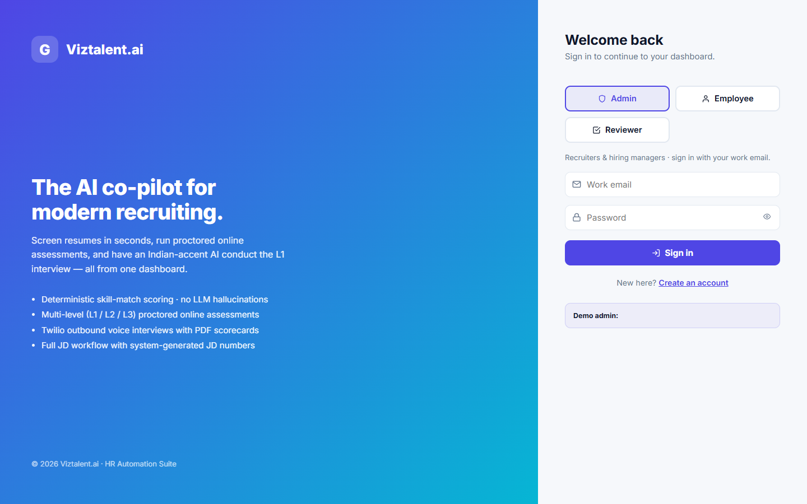

### 1.1 Dashboard and Analytics
- **Dashboard** shows the hiring pipeline at a glance (*Applied → Shortlisted → Assessed → Passed → Interview → Hired*), assessment progress, recent activity and interviews.
- **Analytics** lets you drill into one employee or one job: candidates in the pipeline, shortlisted, assessments completed, average fit score, the hiring funnel, the pass rate and the most-matched skills.

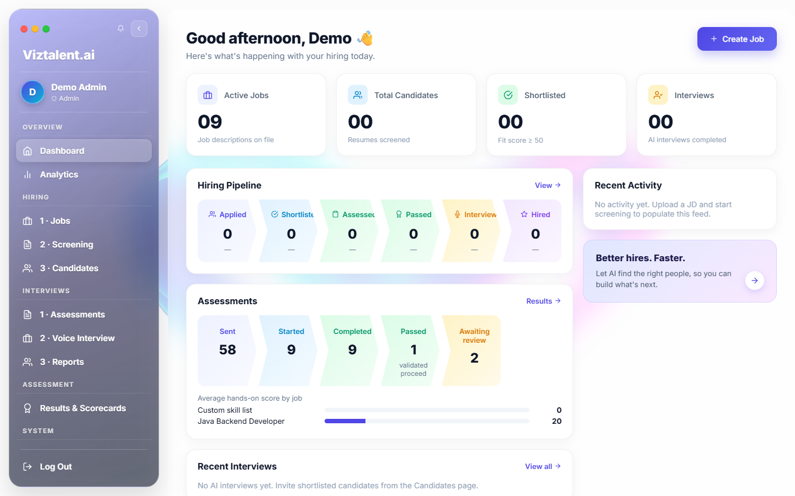

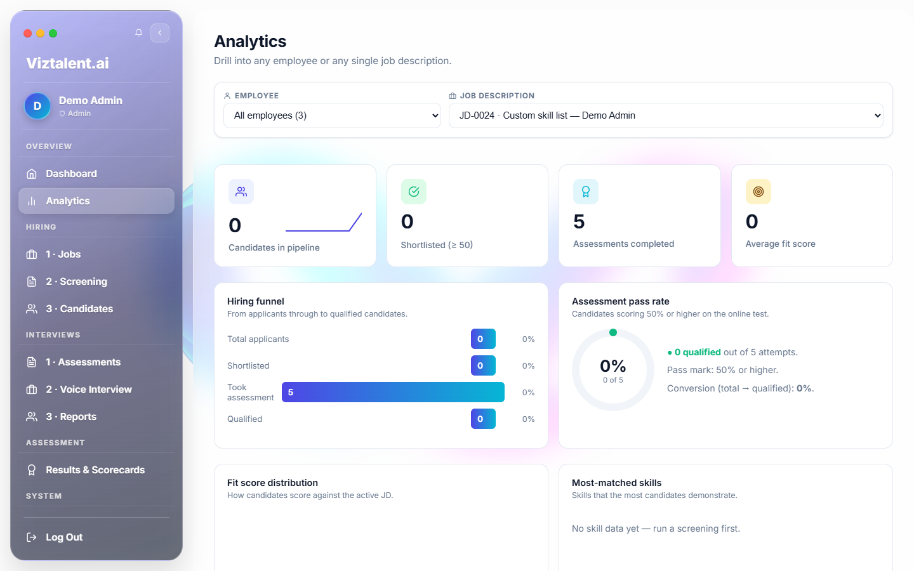

### 1.2 Manage users (System → Employees)
- See every employee, admin and technical reviewer, with last-seen and last-login times.
- **Approve or reject** employees who signed up, and revoke access when someone leaves.
- **Add admin** and **Add reviewer** accounts. Public sign-up only creates employees, so admins and reviewers are added here.

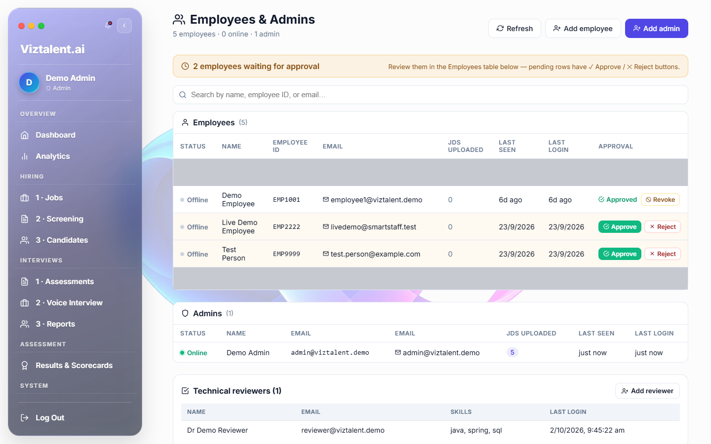

### 1.3 Platform settings (System → Settings)
- **Appearance:** light, dark or system theme.
- **AI provider:** the Gemini API key that writes assessments and interview questions and scores answers. **Save & test** checks the key. If Gemini reports that the key is out of quota, assessments can't be written until you add a key with quota.
- **Assessment prompt:** the instructions the AI follows to write each candidate's assessment (see 1.4).
- **Public URL:** the web address used in every candidate link, for example `https://hiring.yourcompany.com`. A `localhost` address only works on your own computer.
- **Invite validity:** how long a candidate link stays active (default 48 hours).
- **Code runner:** turns on hands-on coding questions and sets the languages candidates can use.
- **Phone calls (optional):** let the AI interviewer phone candidates through a phone provider account.
- **Email:** the sender settings and editable templates for assessment and interview invitations, reminders and rejections.
- **Question bank:** upload your own interview or assessment questions.

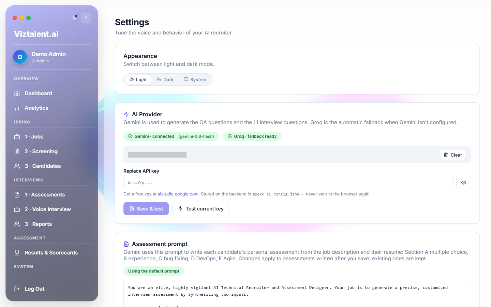

### 1.4 The assessment prompt (System → Settings → Assessment prompt)
Every shortlisted candidate gets their **own assessment**, written by the AI from the job description and that candidate's resume. The prompt sets the structure:

| Section | Questions | What it tests | How it is scored |
|---|---|---|---|
| **A** · Multiple choice | 5 | Core technical concepts from the JD | Automatically |
| **B** · Your experience | 4 | The candidate's own projects, tools and achievements from their resume | AI, against key points |
| **C** · Find and fix the bug | 2–3 | Real code snippets with a bug, bottleneck or unhandled edge case | AI, against key points |
| **D** · DevOps & infrastructure | 1–2 | CI/CD, containers, cloud, deployment, monitoring | AI, against key points |
| **E** · Agile & process | 1 | A practical sprint or team scenario | AI, against key points |

- **Edit** the text and click **Save prompt**. New assessments use it straight away; ones already written are kept.
- **Reset to default** restores the original prompt.
- The prompt must keep the two placeholders `{{INSERT_JOB_DESCRIPTION}}` and `{{INSERT_CANDIDATE_RESUME}}`. The app fills them in and won't save a prompt without them.
- The app checks every AI reply before using it: the right number of questions per section, four different options per multiple-choice question, a code snippet in every bug-fixing question and no repeated questions. If anything is off, it asks the AI again.
- If a job was created from a pasted skill list instead of a full JD, the AI gets the job title, required and nice-to-have skills and experience range instead.

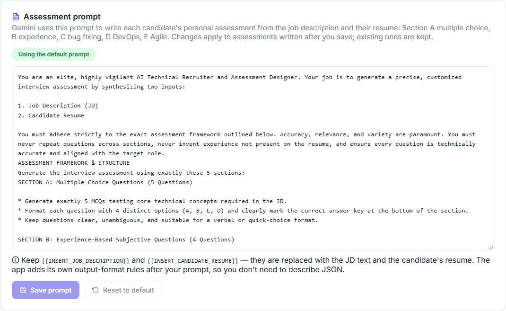

### 1.5 Expert review oversight (System → Expert review)
- See the full review queue, including **overdue** reviews that need attention.
- Admins can also claim and complete reviews themselves.

---

## 2. Interviewer

There are two interviewer roles:

- **HR Recruiter (Employee)** runs the day-to-day hiring pipeline.
- **Technical Reviewer (SME)** checks the AI's work and signs off on results.

### 2.1 HR Recruiter

Sign in on the **Employee** tab. Your menu is organised in the order you'll work.

#### Step 1 — Create a job (Hiring → Jobs)
1. Click **Create a new job**.
2. Upload a job description (PDF / DOC / DOCX, up to 5 MB), or paste the text or a list of skills.
3. The AI extracts the skills, experience requirements, responsibilities and match criteria, and the job gets a **JD number** (e.g. `JD-0020`).
4. Optionally add your own interview questions for this role.
5. Click **Set active** to make it the job you're working on.

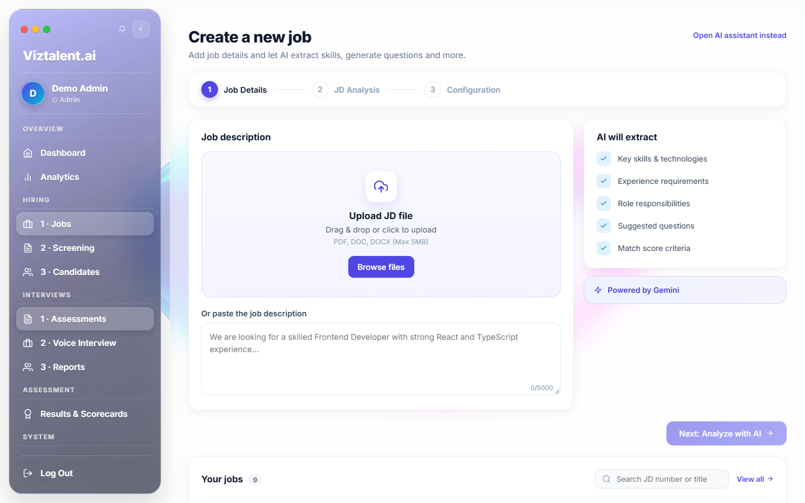

All jobs are listed under **Job Descriptions**, which you can search by JD number, title or skill. From here you can open details, set a job active, or download the original JD.

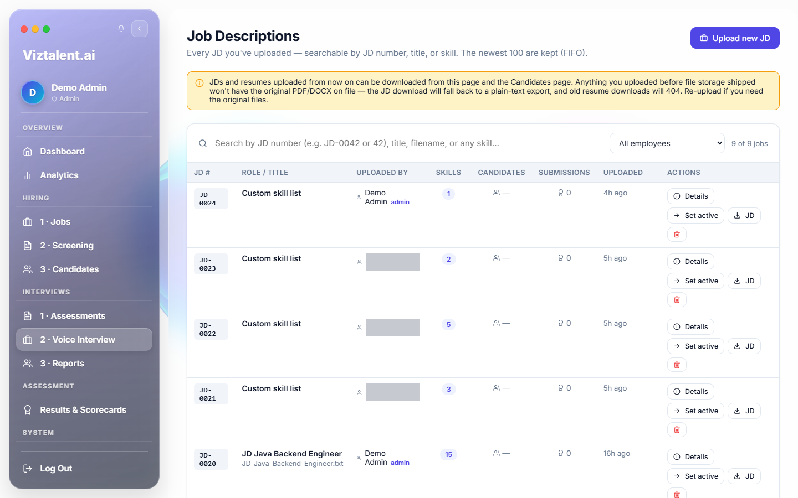

#### Step 2 — Screen resumes (Hiring → Screening)
1. Pick the job and upload candidate resumes in bulk.
2. Click **Run screening**. Each resume is scored against the job's skills, with matches and gaps highlighted.
3. Shortlist the strongest candidates.

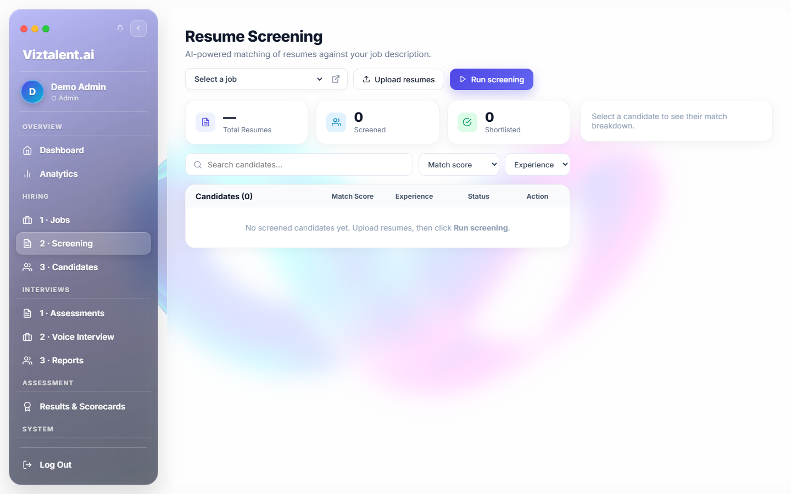

#### Step 3 — Manage candidates and send links (Hiring → Candidates)
- See every candidate for the selected job with fit score, stage, key strengths and contact details; filter by stage or minimum score; **Download Excel**.
- **Compare** several candidates side by side and keep notes.
- **Preview Invite** opens the assessment invitation email. For a screened candidate, the first invite has the AI write their personal assessment, which takes about 20–60 seconds; later invites reuse it. Copy the link, open it in your mail client, or send it straight from Viztalent when email is set up.
- **Interview** creates a personal, secure AI voice-interview link.
- **Preview Rejection** prepares a polite rejection email.

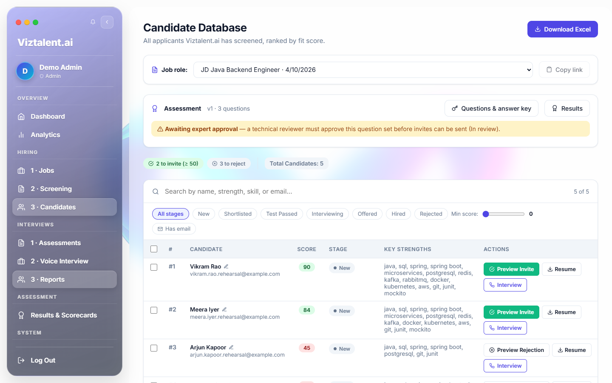

> If the job requires expert approval, the candidate's question set first goes to a technical reviewer. The link becomes available once they approve it.

#### Step 4 — Review results (Assessment → Results & Scorecards)
- For each job, see every attempt with **Theory** and **Hands-on** scores, the overall score, the recommendation and any integrity flags.
- Each result is **Provisional** until a technical reviewer validates it; it then shows as **Validated**.
- Open an attempt to see each answer, the scoring evidence and the **integrity timeline**: warnings, tab switches, fullscreen exits, camera or microphone off, and face, eye and phone alerts with how long each lasted.
- Download a **PDF scorecard** to share. It also states when a test was ended after three proctoring warnings.
- The **L1 interviews** tab shows AI voice-interview transcripts and evaluations.

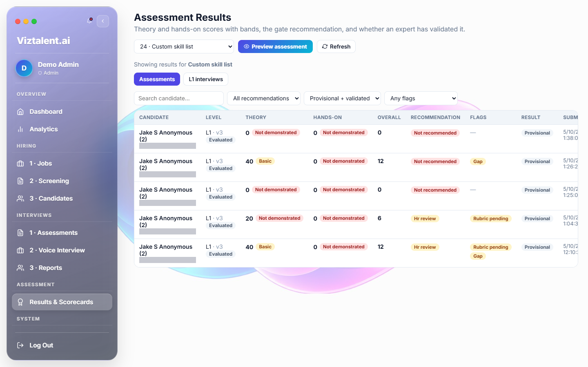

#### Step 5 — Voice interview (Interviews → Voice Interview)
- Run an AI voice interview directly from your own screen, send the candidate a self-service link, or (if phone calls are set up) have the AI **call the candidate**.

### 2.2 Technical Reviewer (SME)

Sign in on the **Reviewer** tab. Reviewers only see the **Review queue**, so experts can focus on validation.

#### The review queue
Items are listed oldest due first:
- **Question sets** waiting for approval, including each candidate's personal assessment when the job requires approval
- **Assessment results** waiting for sign-off
- **AI interviews** waiting for sign-off

Click **Claim** to take ownership of an item, so two reviewers don't work on the same thing.

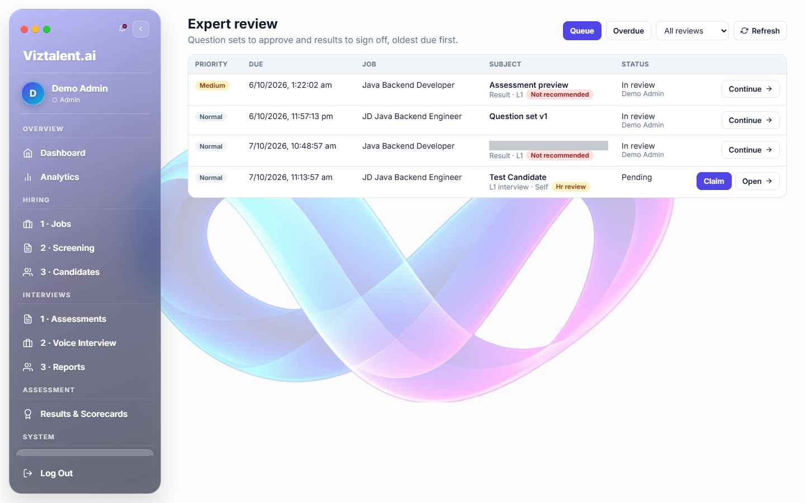

#### Reviewing a question set
1. Check the generated questions and their answer key.
2. **Edit** or **Regenerate** any question that isn't right.
3. **Approve** the set, which unlocks the candidate's link, or **Return** it with a comment.

#### Reviewing an assessment attempt
1. For each question, compare the candidate's answer with the model answer, the key points and the AI's quoted evidence.
2. **Confirm** the AI score, or **Adjust** it. Adjusting requires a reason.
3. Check the **integrity timeline** (see Step 4 above). Face, eye and phone alerts are evidence for you to judge; they don't lower the score by themselves.
4. Set the final skill bands, recommendation and comment.
5. **Sign off** to validate the result, or **Return to HR**.

#### Reviewing an AI interview
1. Read the transcript, with each answer shown next to the expected points.
2. Confirm or adjust each answer's score, with a reason.
3. Override the bands or recommendation if needed, then **Sign off** or **Return to HR**.

---

## 3. Candidate

Candidates **don't need an account**. Everything works from the secure link in the invitation email. The link is personal, works for a limited time (48 hours by default) and can't be reused once completed.

### 3.1 Before you start
- Use a **laptop or desktop** with **Google Chrome or Microsoft Edge**. Phones and tablets are not supported.
- You need a working **webcam and microphone**.
- Sit somewhere quiet and well lit, alone, with your face clearly visible.
- Put your phone away and close other apps and tabs.
- Make sure your internet connection is stable.

### 3.2 Starting the assessment
1. Open the **assessment link** from your email and read the instructions.
2. Click **Allow camera & microphone** and accept the browser's request. You'll see yourself in the preview.
3. Tick the box to agree to proctoring.
4. Click **Start assessment in fullscreen**. **The timer starts now.**

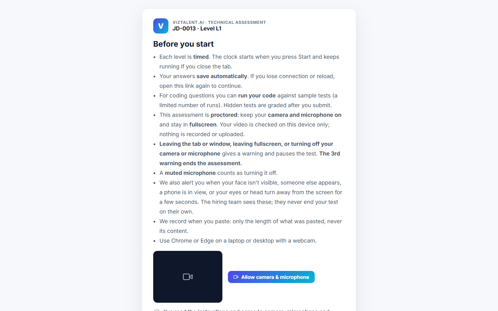

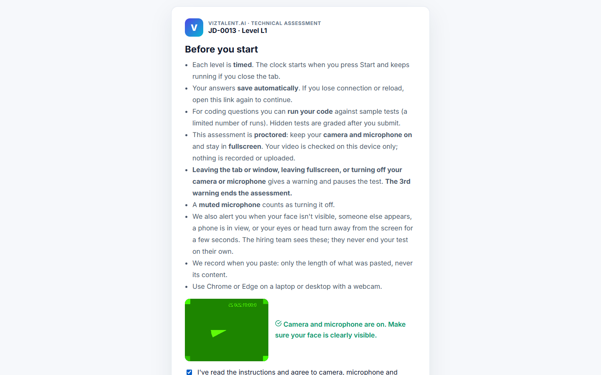

### 3.3 Taking the assessment
- The questions are listed on the left. **Section A** is multiple choice; **Sections B–E** need a written answer.
- **Bug-fixing questions** (Section C) show the code. Explain the bug, why it happens and how to fix it.
- Your answers **save automatically**. If the page reloads or your connection drops, open the same link again and click **Continue in fullscreen**; your answers and the timer carry on.
- The top bar shows your **warnings (0/3)**, the save status, the **time left** and **Submit**. A small camera preview stays in the corner.
- Click **Submit** when you're done. You'll be told about any unanswered questions first.

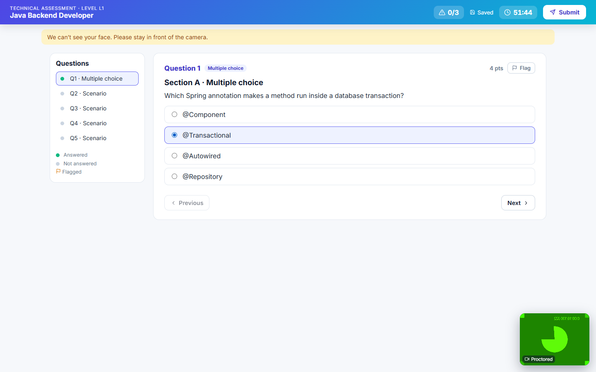

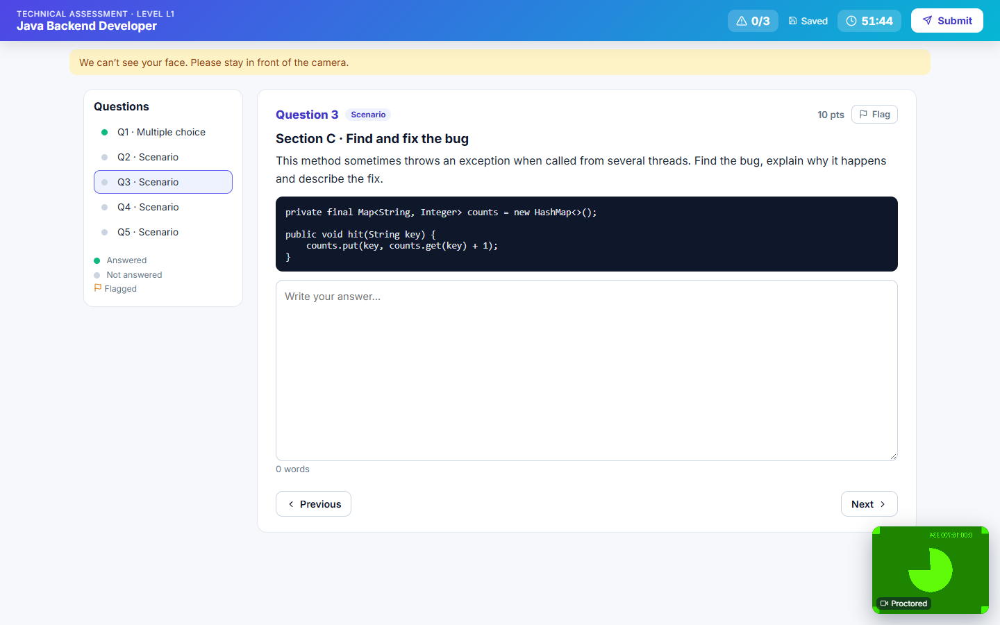

### 3.4 Proctoring: alerts and warnings
The assessment watches for two kinds of problems.

**Alerts** never end your test. A pop-up asks you to fix the problem; click **OK, continue** to carry on. The hiring team sees each alert and how long it lasted.

| Alert | When it appears |
|---|---|
| Face not visible | No face in the camera for a few seconds |
| More than one face | Someone else appears on camera |
| Looking away | Your eyes or head stay turned away from the screen for a few seconds |
| Phone visible | A phone is in view of the camera |

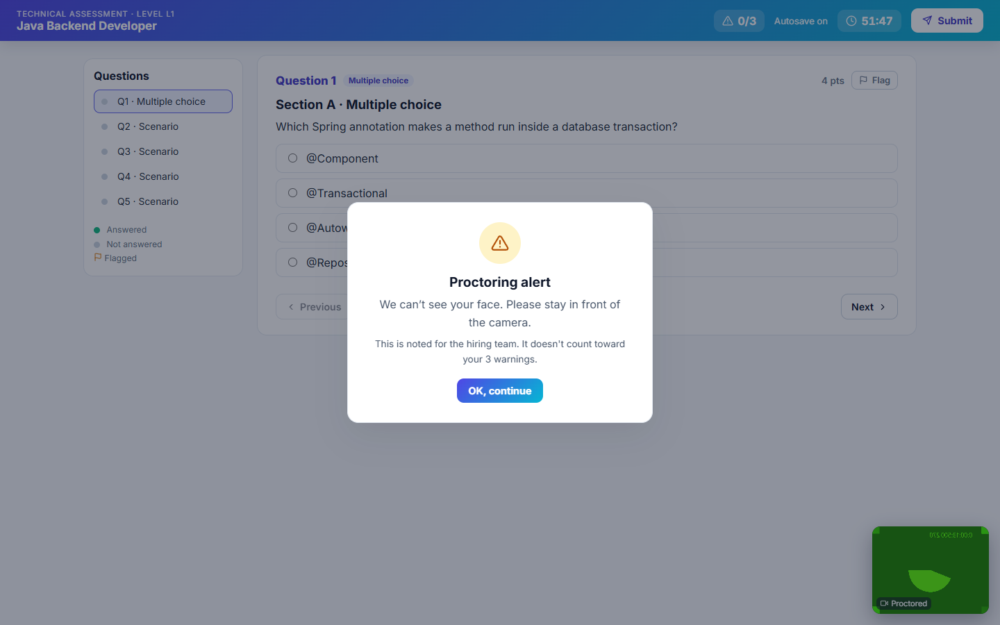

**Warnings** pause the test. Click **OK, continue** to return. **The 3rd warning ends the assessment** and submits the answers you've given so far.

| Warning | When it happens |
|---|---|
| Left the tab or window | You open another tab or switch to another app |
| Left fullscreen | You exit fullscreen |
| Camera off | Your camera is turned off or disconnected |
| Microphone off | Your microphone is muted, turned off or disconnected |

The timer keeps running while a warning is shown.

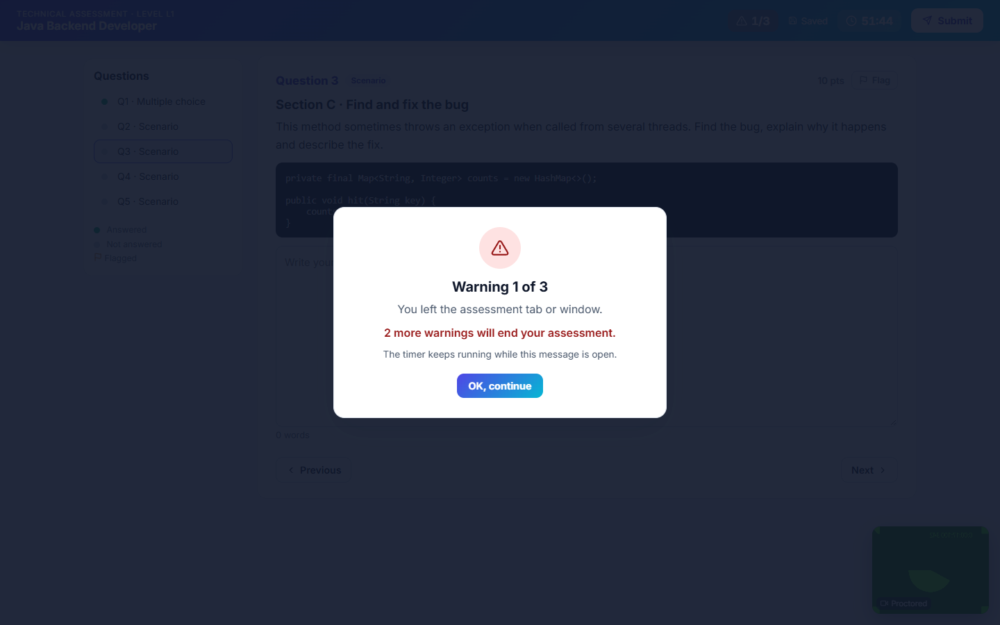

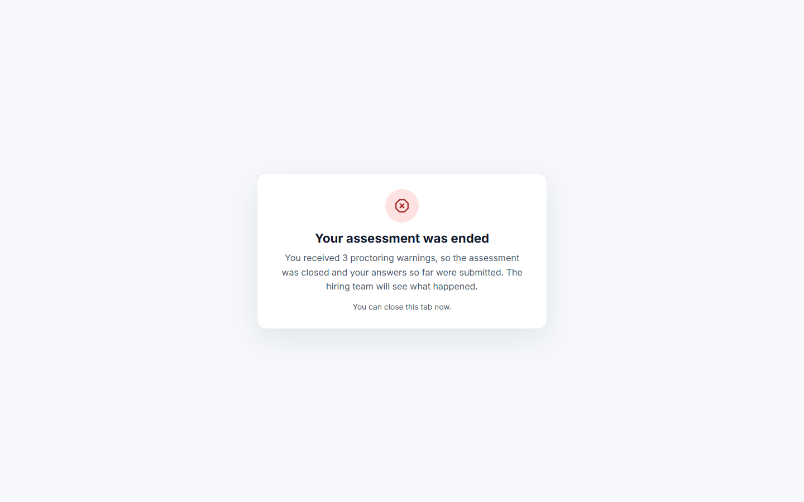

Your video and audio are checked **on your own device only**. Nothing is recorded or uploaded.

### 3.5 AI voice interview
1. Open the **interview link** from your email.
2. The welcome screen shows the role, the number of questions and the language.
3. Click **Test microphone access** and allow the browser to use your microphone.
4. The AI interviewer reads each question aloud. Answer out loud as you would in a normal phone interview.
   - Click **Next question** when you've finished an answer.
   - Click **Repeat question** if you'd like to hear it again.
   - Pauses are fine. Speak naturally.
5. After the last question, a thank-you screen confirms the interview is complete.

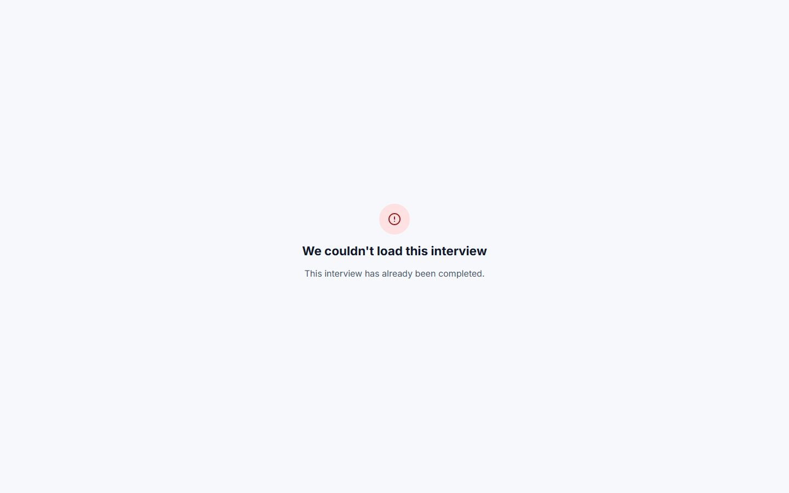

### 3.6 If something doesn't work
| Message | What it means |
|---|---|
| *Link is invalid* | The link was copied incompletely. Open it straight from the email. |
| *Link has expired* | The time window has passed. Ask the recruiter for a new link. |
| *Already completed* | This assessment or interview was already submitted. |
| *Camera and microphone access was blocked* | Click the camera icon in the address bar, allow both, then try again. |
| *Your camera or microphone is being used by another app* | Close the other app (Zoom, Teams, etc.) and try again. |
| *Return to fullscreen* | Click **OK, continue** to go back into fullscreen. This doesn't count as a warning when the test has just started or reloaded. |

---

## Quick reference

| I want to… | Role | Where |
|---|---|---|
| Add an admin or reviewer | Admin | System → Employees |
| Change how assessments are written | Admin | System → Settings → Assessment prompt |
| Set the AI key, candidate link address or email | Admin | System → Settings |
| Create a job | Recruiter | Hiring → Jobs |
| Screen resumes | Recruiter | Hiring → Screening |
| Send an assessment or interview link | Recruiter | Hiring → Candidates |
| See scores, integrity alerts and download a scorecard | Recruiter | Assessment → Results & Scorecards |
| Approve questions or validate results | Reviewer | Review queue |
| Take the assessment or interview | Candidate | The link in the invitation email |
